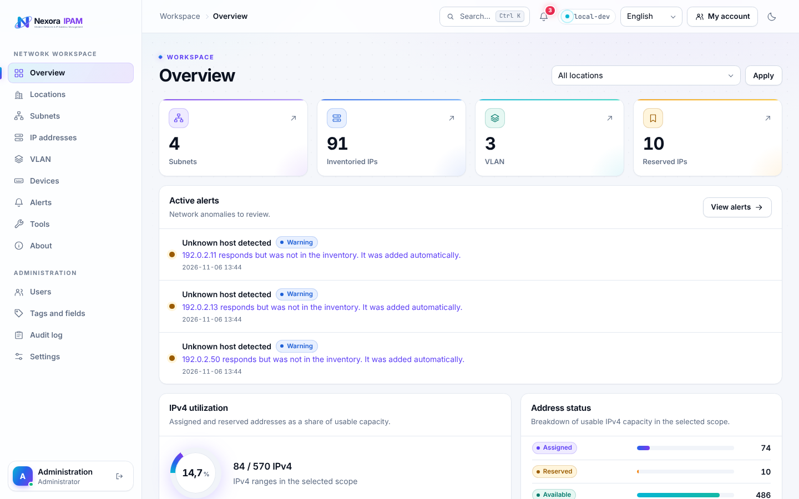
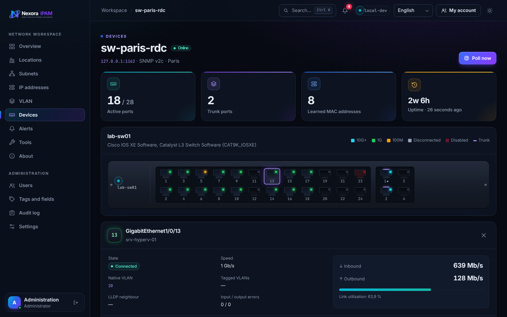
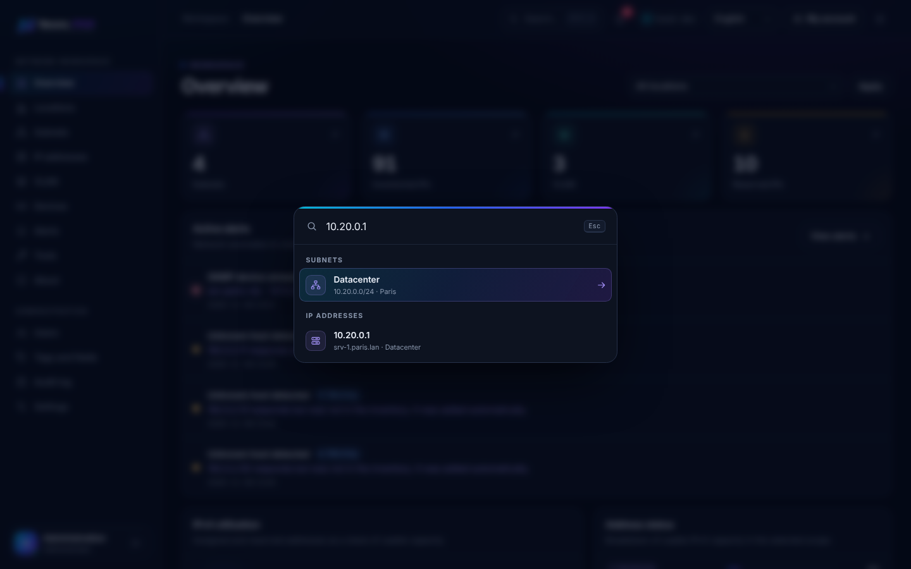
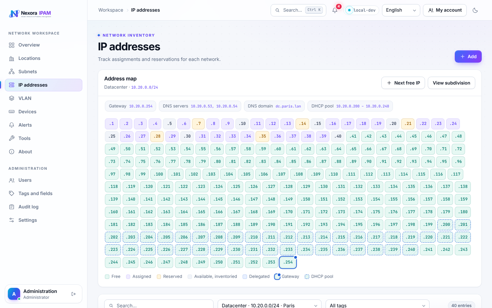

<p align="center">
  <picture>
    <source media="(prefers-color-scheme: dark)" srcset="public/brand/nexora-logo-dark.svg">
    
  </picture>
</p>

<p align="center">
  <strong>Modern IP address management for teams who want to see their network, not a spreadsheet.</strong>
</p>

<p align="center">
  <a href="https://github.com/pokertour/NexoraIPAM/actions/workflows/ci-release.yml"></a>
  <a href="https://github.com/pokertour/NexoraIPAM/releases"></a>
  
  
  
  <a href="LICENSE"></a>
</p>

<p align="center">
  <a href="#features">Features</a> ·
  <a href="#quick-start-with-docker">Quick start</a> ·
  <a href="#with-docker-compose">Compose</a> ·
  <a href="#local-development">Development</a> ·
  <a href="#configuration">Configuration</a> ·
  <a href="#license">License</a>
</p>

<p align="center">
  <picture>
    <source media="(prefers-color-scheme: dark)" srcset=".github/assets/dashboard-dark.png">
    
  </picture>
</p>

NexoraIPAM keeps track of your subnets, IP addresses, VLANs and network devices in one place. It discovers hosts with ICMP, reads switches and routers over SNMP, raises alerts on conflicts and full subnets, and records every change in an audit log. The interface is available in English and French, with light and dark themes.

## Features

### 🗺️ Inventory
- **IPv4 and IPv6 subnets** organised by location: agency, office and floor.
- **Interactive address map** showing free, assigned and reserved addresses, the gateway and the DHCP pool.
- **Subnet planning**: split a range into smaller blocks and delegate them.
- **Next free IP** in one click, skipping the gateway, the DHCP pool and delegated blocks.
- **Network settings** per subnet: gateway, DNS servers, DNS domain and DHCP range.
- **VLANs**, **tags** and **custom fields** (text, number, link, date, list) on subnets, addresses and VLANs.

### 🔌 Switches and routers over SNMP
- SNMP v2c and v3, with credentials encrypted at rest.
- A **live front panel** of each switch. For every port: link state, speed, native and tagged VLANs, throughput, learned MAC addresses and LLDP neighbour.
- The router **ARP table** fills in MAC addresses and adds unknown hosts to the inventory.
- Uses standard MIBs (IF-MIB, BRIDGE-MIB, Q-BRIDGE-MIB, LLDP-MIB, IP-MIB), so it works across vendors.

<p align="center"></p>

### 📡 Discovery, history and alerts
- **ICMP discovery** with reverse DNS and ARP/NDP MAC collection, on demand or on a schedule.
- **Address history**: every MAC address and host name seen on an IP, plus the switch port it is plugged into.
- **Alerts** for subnets over a usage threshold, unknown hosts, available addresses that respond, MAC changes, hosts that go silent and unreachable devices. Alerts can be acknowledged and sent by e-mail.

### 🔍 Global search
Press <kbd>Ctrl</kbd> + <kbd>K</kbd> (or <kbd>/</kbd>) anywhere to open the search:
- An IP address also lists every subnet that contains it.
- A MAC address, in any format, shows the switch port where it was learned.

<p align="center"></p>

### 🛡️ Security and accountability
- **Roles**: administrator, operator and viewer.
- **Sign-in**: local accounts with TOTP two-factor authentication, LDAP group membership, or OpenID Connect with PKCE.
- **Audit log**: every creation, change and deletion with its author, IP address and before/after values. Secrets are masked. Sign-ins, settings changes, discoveries, SNMP polls and alerts are recorded too.

<p align="center"></p>

## Quick start with Docker

The image is published on GHCR as `ghcr.io/pokertour/nexoraipam:vX.X.X`. It runs FrankenPHP on PHP 8.5 and listens on port 8080.

1. Generate an application key. It is 32 random bytes, base64-encoded with the `base64:` prefix:

   ```sh
   echo "base64:$(openssl rand -base64 32)"
   ```

2. Create a `nexora.env` file with this key and the public URL of the application:

   ```ini
   APP_KEY=base64:...
   APP_URL=https://ipam.example.com
   ```

   Or generate the file in one go:

   ```sh
   printf 'APP_KEY=base64:%s\nAPP_URL=%s\n' "$(openssl rand -base64 32)" https://ipam.example.com > nexora.env
   ```

3. Start the container:

   ```sh
   docker volume create nexora-data
   docker run -d --name nexora --env-file nexora.env \
     -v nexora-data:/var/lib/nexora -p 8080:8080 \
     ghcr.io/pokertour/nexoraipam:vX.X.X
   ```

4. Read the temporary administrator password in the logs, then sign in as `admin@example.com`. You will be asked to change the password on first sign-in.

   ```sh
   docker logs nexora
   ```

### With Docker Compose

The repository ships a [`compose.yaml`](compose.yaml). Put it in a directory with your `nexora.env` file, created as in step 2 above, then:

```sh
docker compose up -d
docker compose logs nexora   # temporary administrator password
```

| Variable | Default | Purpose |
| --- | --- | --- |
| `NEXORA_VERSION` | `latest` | Image tag to run, for example `v0.0.3`. |
| `NEXORA_PORT` | `8080` | Port published on the host. |

To upgrade, change `NEXORA_VERSION` or run `docker compose pull`, then `docker compose up -d`. To try local changes, build the image with `docker build -t ghcr.io/pokertour/nexoraipam:dev .`, then start it with `NEXORA_VERSION=dev docker compose up -d`.

On every start, the container applies database migrations and makes sure the initial account exists. Supervisor then runs three processes: FrankenPHP, the queue worker that performs discoveries and SNMP polls, and the scheduler. Keep the same `APP_KEY` and volume across upgrades: the key decrypts the stored settings and credentials.

The worker probes networks from the container, so the container must be able to reach them. Any other command, for example `docker run --rm <image> php artisan …`, runs without starting the services.

## Local development

Requirements: PHP 8.3+ with PDO SQLite, Composer, Node.js 20.19+ or 22.12+ and npm. Install the PHP LDAP extension only if you use directory sign-in.

```sh
composer install
cp .env.example .env
php artisan key:generate
touch database/database.sqlite
php artisan migrate
npm ci && npm run build
php artisan nexora:install   # prints the temporary administrator password
php artisan serve
```

Discoveries and SNMP polls run on the `discovery` queue. Start the worker and the scheduler next to the web server:

```sh
php artisan queue:work database --queue=discovery
php artisan schedule:work
```

The worker host needs a few system tools:

| Feature | Tools |
| --- | --- |
| ICMP discovery and reverse DNS | `ping` (iputils) and `getent` |
| MAC addresses from ARP/NDP | `iproute2` |
| SNMP | `snmp` on Debian/Ubuntu, `net-snmp-tools` on Alpine |
| MAC vendor lookup in **Tools** | `ieee-data`, or the IEEE CSV files in `/usr/share/ieee-data` |

In production, set `APP_ENV=production` and an HTTPS `APP_URL`, point the web server to `public/`, run `php artisan schedule:run` every minute, and keep the `discovery` worker running.

## Configuration

Administrators configure everything from **Settings** in the application. Authentication and SMTP settings are stored encrypted.

| Role | Access |
| --- | --- |
| Administrator | Inventory, devices, users, tags and fields, audit log and settings |
| Operator | Read and edit the inventory, acknowledge alerts |
| Viewer | Read the inventory, devices and alerts |

- **Local accounts**: create them in **Users** and share the temporary password. The installation account keeps local access as a fallback when local sign-in is disabled.
- **LDAP**: enter the LDAPS URL, base DN, allowed AD group DN and service account. Direct and nested members of the group sign in with their `mail` attribute and get a viewer account on first sign-in. Install the directory CA in the server trust store if needed.
- **OpenID Connect**: register a confidential client using HTTPS discovery, the authorization code flow, PKCE S256 and RSA signatures. Declare the callback URL shown in **Settings** (`/auth/openid/callback`) at your provider. Authorized users get a viewer account on first sign-in.
- **SMTP**: set the sender, server and credentials, then use **Send a test**. Implicit TLS and STARTTLS are supported.
- **Alerts**: set the IPv4 usage threshold, choose which conflicts to report and whether new alerts are sent by e-mail.
- **SNMP devices**: add each device in **Devices** with its address, UDP port and v2c community or v3 credentials. Read-only access is enough. Set an interval to poll it automatically. Throughput appears from the second poll.
- **Automatic discovery**: set an interval in minutes on a location. It applies to the subnets attached directly to that location.

SQLite is the default database. Other databases are configured through the standard Laravel `DB_*` variables.

## Releases

Pushes and pull requests run the test suite. To publish a version, open **Actions → Tests et publication → Run workflow** and enter `vX.X.X`. The workflow then:
1. runs the tests;
2. builds and checks the image;
3. pushes the version and `latest` tags to GHCR;
4. creates the GitHub release.

The **About** page checks for the latest release. For a private repository, set `GITHUB_RELEASE_TOKEN` to a token with read access.

## Testing

```sh
vendor/bin/phpunit
npm run build
```

## License

NexoraIPAM is **source-available**, not open source. It is released under the [NexoraIPAM Source Available License v1.0](LICENSE). In short:

- ✅ You may read the code and use NexoraIPAM for free, including inside a company, for your own internal needs.
- ✅ You may modify it for your own internal use.
- ❌ You may not redistribute it, publish forks, or offer it as a hosted service without written permission.
- ❌ Paid services built on NexoraIPAM require prior authorization: installation, integration, hosting, support or training for third parties.

This summary is for convenience only: the [license text](LICENSE) is authoritative. Contributions are welcome under the terms described in [CONTRIBUTING.md](CONTRIBUTING.md).

<p align="center"><sub>Made by <a href="https://github.com/pokertour">pokertour</a></sub></p>
